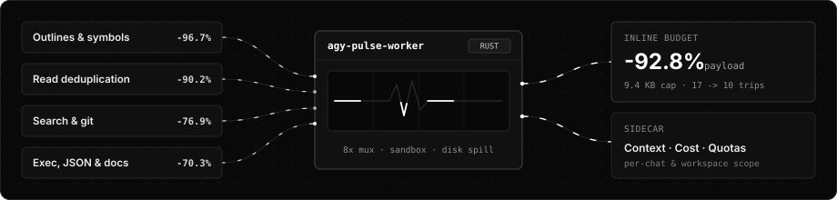
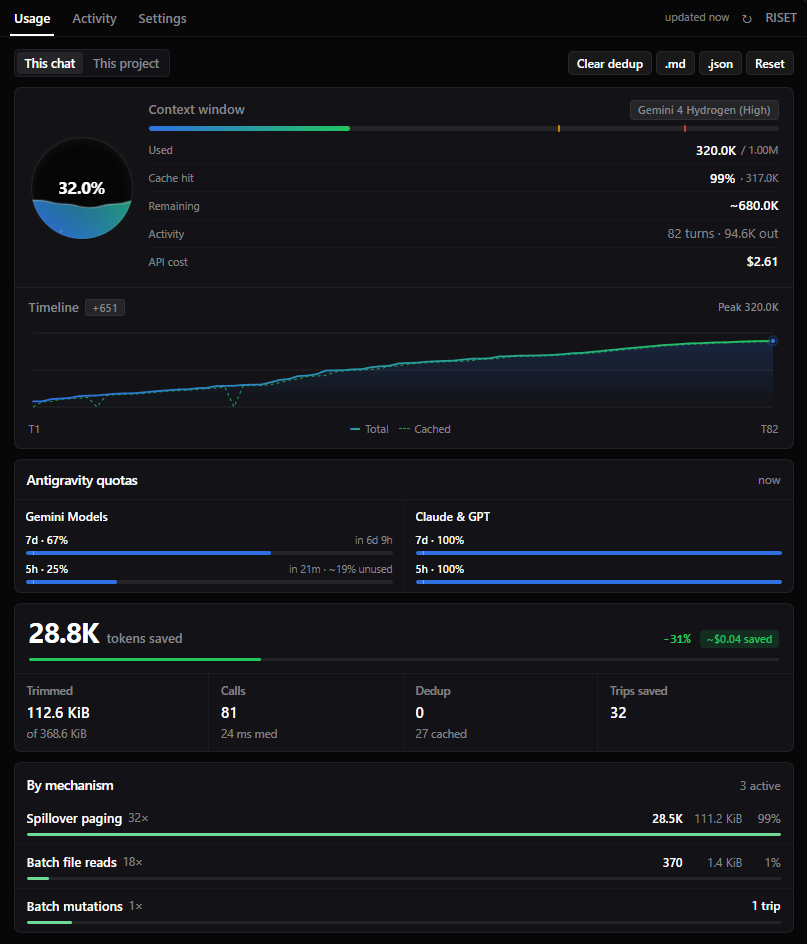

<div align="center">
  
  <h1>agy-pulse</h1>
  <p>Native Rust workspace engine, compact MCP tools, and per-conversation telemetry for Google Antigravity.</p>
</div>

<picture>
  <source media="(prefers-color-scheme: dark)" srcset="assets/pulse-motion.svg" />
  <source media="(prefers-color-scheme: light)" srcset="assets/pulse-motion-light.svg" />
  
</picture>

`agy-pulse` is a Google Antigravity plugin for workspace operations, token reduction, and live usage tracking. It pairs a persistent Rust worker (`agy-pulse-worker`, compiled with `#![forbid(unsafe_code)]`), a local Sidecar daemon, lifecycle hooks, and seven `pulse_*` MCP tools. Inline MCP responses stay under 9,400 bytes, and anything larger spills to disk under a `ref://spill/...` handle that can be paged or searched later.

## MCP tools

| Tool | What it does |
| --- | --- |
| `pulse_read_files` | Batch reads (1 to 32 files), structural outlines, single-symbol fetches, stat, and hex |
| `pulse_search` | `.gitignore`-aware glob, fuzzy lookup, 5-mode grep, and compact `git_status` / `git_diff` |
| `pulse_mutate` | Atomic compare-and-swap edit/write, diff preview, workspace replace, and file batch ops |
| `pulse_read_doc` | Native CSV, TSV, DOCX, and PDF pagination without helper scripts |
| `pulse_exec` | Shell execution with log folding, JSON digests, and foreground timeout promotion |
| `pulse_job` | Blocking output wait, stdin forwarding, status, and tree kill for background jobs |
| `pulse_result` | Line-bounded paging and regex search over spilled outputs, plus live session stats |

### Reading files (`pulse_read_files`)

Reads up to 32 files in parallel inside Rust and factors out shared base paths. Pass `view: "outline"` to pull imports, types, classes, structs, and function signatures before reading full bodies. The outline parser supports TypeScript, JavaScript, Rust, Python, Go, Java, Kotlin, C#, C, C++, Ruby, PHP, Markdown, JSON, YAML, CSS, SCSS, HTML, Vue, and Svelte.

Pass `symbol: "<name>"` to extract one declaration block, `stat_only: true` for file metadata and SHA-256 revisions, or `view: "hex"` with a 0-based byte offset for binary files. Rust symbol lookup keeps generic and reference `impl` targets (`Box<T>::len`, `&mut T::len`) alongside short names. When an agent asks for a line range or symbol span it already saw in the same conversation at the same SHA-256 revision, the tool replies with a one-line `[Unchanged]` notice. Deduplication state persists across daemon restarts, and telemetry counts each `(path, revision)` full-file baseline once per session so fetching several symbols from one file does not inflate raw bytes. Multi-file batches allocate their inline budget with water-fill middle truncation so headers and file paths stay intact.

### Searching and git (`pulse_search`)

Runs `glob` walks with `!exclude` negation and stacked parent and nested `.gitignore` rules, `fuzzy` file lookup, 5-mode `grep` (`summary`, `count`, `files_with_matches`, `definitions`, `content`), and compact `git_status` and `git_diff` views. Lockfiles like `package-lock.json` and `Cargo.lock` are summarized and skipped unless you pass `include_lockfiles: true`. Long diff hunks truncate at `max_hunk_lines`, and both `git_status` and `git_diff` redact credential-fenced filenames.

### Editing files (`pulse_mutate`)

Performs atomic `edit` and `write` operations. Pass `expected_revision` (a SHA-256 hash or `"absent"` for new files) for compare-and-swap checks so stale edits fail with `effectState: "none"` before touching disk; omit it when you want direct writes or multi-hunk edits. Failed `edit` calls return a closest-region snippet to help locate shifted lines.

The same tool handles unified `diff` previews, workspace-wide `replace`, and preflighted `batch` operations (`copy`, `move`, `remove`) with `dry_run`. Applied mutations invalidate affected paths in the conversation's read-dedup cache, and large diffs spill to disk automatically.

### Reading documents (`pulse_read_doc`)

Parses `CSV`, `TSV`, `DOCX`, and `PDF` files inside Rust with row, paragraph, or page pagination. With `format: "auto"`, the format is inferred from the file extension so agents do not need to write one-off Python or PowerShell scripts.

### Running commands and jobs (`pulse_exec` and `pulse_job`)

`pulse_exec` runs inline commands (`command`) or script files (`script_path`) on `pwsh` (including Microsoft Store App Execution Aliases on Windows), `powershell`, `git-bash`, `wsl`, `cmd`, `bash`, `zsh`, and `sh`. Commands inherit non-interactive defaults (`NO_COLOR=1`, `TERM=dumb`, `PAGER=cat`, `GIT_PAGER=cat`), strip loader and hook hijack environment variables (`LD_PRELOAD`, `DYLD_INSERT_LIBRARIES`, `NODE_OPTIONS`, `BASH_ENV`, `GIT_SSH_COMMAND`, `PYTHONSTARTUP`), normalize ANSI and carriage returns, fold passing build noise, and pack failure logs around the first error cluster and tail. Exit handling includes a short stream-close grace window so background grandchildren holding inherited pipes do not hang foreground calls.

Valid JSON output between 8 KiB and 2 MiB returns a compact `[JSON Digest]`. Output larger than `maxInlineBytes` (7,800 bytes default, 8,800 bytes cap) spills to disk under `ref://spill/...`. Foreground timeouts cap at 165 seconds (under Antigravity's 180-second MCP limit) so long commands promote into background jobs before the host aborts the tool call.

`pulse_job` lists, reads, sends stdin to, and kills background or promoted jobs along with their child process trees. Passing `action: "output"` with `wait: true` blocks until new output arrives or the process exits, and omitting stream offsets resumes from the job's last read cursor.

### Paging spills and checking stats (`pulse_result`)

Pages, regex-searches, or releases spilled `ref://spill/...` files on disk (`action: "page"` or `"release"`). Default pages cap at 7.2 KB on line boundaries so lines do not clip against the 9.4 KB MCP response ceiling. Calling `action: "stats"` returns token savings for the current session, live Context Window usage, Antigravity quota pools, host MCP health, daemon version-skew checks, active spills, Rust worker status, and detected shells.

## Sidecar panel

<div align="center">
  
</div>

The React Sidecar panel (`sidecar://agy-pulse/pulse/`) syncs over HTTP long-polling and WebSocket across three tabs:

- **Usage** toggles between **This chat** and **This project** (scoped strictly to conversations in the active workspace). In **This chat**, the Context Window card shows current fill, cache hit rate, turn-by-turn timeline, and cumulative **API cost** calculated per turn from official Google Gemini, Claude, and GPT list rates (hovering shows Input, Cached, Output, Google's prompt cache discount, and your Google AI Plus / Pro / Ultra percentage). Below that is a two-column **Antigravity quotas** card (Gemini on the left, Claude & GPT on the right, read via `agy -p /usage` with a loopback `language_server` fallback), followed by Pulse token savings (with direct dollar savings kept separate from Google's prompt cache discount) and a breakdown by mechanism. Switching to **This project** hides the per-chat Context Window card and aggregates savings across conversations in the current project.
- **Activity** shows live running jobs, tool history, a text search bar with a category dropdown (`All`, `Running`, `Errors`, `Read`, `Search`, `Mutate`, `Exec`, `Spilled`), stdin input, and inline spillover paging.
- **Settings** covers default shell, Google AI subscription plan (`Plus`, `Pro`, `Ultra 5x`, `Ultra 20x`, or hidden), safety switches, a collapsed **Advanced limits** section (timeouts, spill caps, retention), and a collapsed **Advanced cost rates** table where you can override per-model Input / Cache / Output rates (`$/1M`) if provider pricing changes while keeping built-in defaults untouched.

## Hooks, worker concurrency, and CLI mode

`SessionStart` and `PreInvocation` hooks bind the active conversation ID, workspace roots, and `transcriptPath` into a multi-workspace registry so parallel chats in different repositories do not interfere with each other. On `SessionStart`, the hook injects a repository snapshot capped at 1.5 KB within a 250 ms scan budget.

A selective `PreToolUse` guard (`agy-pulse-tool-guard`) intercepts built-in workspace tools (`run_command`, `read_file`, `edit_file`, `write_file`, `swarm`, and IDE aliases) while letting `pulse_*` calls pass directly. Allowlists cover non-workspace paths, media and PDFs, artifacts, `IsDaemon: true`, and host-authenticated CLIs. You can toggle the guard with `config --tool-guard on|off` or `AGY_PULSE_DISABLE_TOOL_GUARD=1`.

The persistent Rust worker multiplexes up to 8 concurrent requests using `reqId` tags so a heavy `grep` or PDF read does not block parallel file reads or stat calls, and bounds IPC payload sizes so large batches spill cleanly instead of hitting the 4 MiB stdout ceiling.

Swarm workers and scripts without MCP access can call the same engine over the CLI:

```bash
node sidecars/pulse/dist/mcp-server.mjs --cli <read|outline|search|mutate|doc|exec|job|result|quotas|doctor> --cwd <repo> --session <id>
```

CLI mode supports `--cwd <dir>`, `--session <id>` (or `AGY_PULSE_SESSION_ID`), `--stdin` for JSON arguments, `--json` for machine-readable output, `--cli quotas [--refresh]`, `--cli doctor [--repair]`, and per-subcommand `--help`. Interactive TTY runs format output with gutters and compact bars while respecting `NO_COLOR` and `FORCE_COLOR=0`; piped output stays plain text.

## Benchmarks and trade-offs

Measured A/B across seven workspace tasks on a 210-file Rust repository (edition 2024, Windows 11, stdio JSON-RPC MCP, tokens estimated at `ceil(bytes / 4)`):

| Task | Without `agy-pulse` | With `agy-pulse` | Payload delta | Trips | Wall time |
| --- | --- | --- | --- | --- | --- |
| Repo discovery (`**/*`) | 8,232 B (~2,058 tok) | 3,531 B (~883 tok) | -57.1% | 1 to 1 | 4.3 ms to 117.4 ms |
| Codebase search (type symbol in `*.rs`) | 7,605 B (~1,902 tok) | 1,753 B (~439 tok) | -76.9% | 1 to 2 | 10.1 ms to 8.8 ms |
| API inspection (8 Rust source files) | 361,091 B (~90,273 tok) | 11,971 B (~2,993 tok) | -96.7% | 8 to 2 | 0.4 ms to 8.8 ms |
| Re-reading 4 seen files (45 lines each) | 6,566 B (~1,642 tok) | 643 B (~161 tok) | -90.2% | 4 to 1 | 0.2 ms to 1.3 ms |
| Small single file (406 B `Cargo.toml`) | 406 B (~102 tok) | 603 B (~151 tok) | +48.5% | 1 to 1 | 0.1 ms to 1.1 ms |
| Warm `cargo test` (single crate) | 1,641 B (~411 tok) | 1,036 B (~259 tok) | -36.9% | 1 to 1 | 192.9 ms to 601.8 ms |
| Large JSON (`cargo metadata --no-deps`) | 35,900 B (~8,975 tok) | 10,651 B (~2,663 tok) | -70.3% | 1 to 2 | 36.4 ms to ~225 ms |
| Total (7 tasks) | 421,441 B (~105,363 tok) | 30,192 B (~7,548 tok) | -92.8% | 17 to 10 | 244.4 ms to ~960 ms |

In a separate 10-run `hook-session.mjs` timing check, `PreToolUse` averaged `~41.9 ms/call` when denying a guarded built-in tool and `~41.4 ms/call` on the unrelated-MCP allow path. The v1.0.0 test suite runs 88 Node tests, 14 Rust unit tests, 6 stress checks, and 7 doctor checks.

### Known trade-offs

Single reads under ~600 bytes add about 197 bytes of path, revision, and fence metadata (`+48.5%` on a 406-byte `Cargo.toml`). Batching related files into one `pulse_read_files` call spreads that header across the batch.

Local wall-clock latency is roughly 3.8x slower on small local commands (`244 ms` vs `~960 ms`) because `pulse_exec` pays PowerShell startup on Windows (~400 ms), cold Rust worker startup takes ~100 ms on the first call, and each `PreToolUse` hook spawns Node (~42 ms). On full agent turns, keeping ~98K tokens out of the prompt outweighs ~700 ms of local startup time, though one-off tiny shell commands feel faster without `pwsh`.

Batching many large outlines in a single call hits the 9,400-byte inline ceiling and spills the remainder to disk. Spilled reads skip `readDedup` on purpose so truncated unread lines are never marked as seen.

Antigravity does not expose plugin MCP servers or `PreToolUse` hooks inside `/swarm` worker conversations. For `/swarm`, the coordinator hook rewrites `swarm` `add` briefs to include `--cli --cwd <dir> --session "swarm-<name>"` so workers can still reach the engine while staying free to use built-in tools for tiny files.

## Safety guards

Path validation runs in both Node.js and Rust. Relative paths resolve against the active workspace root, MSYS drive paths normalize on Windows, and drive-less POSIX paths on Windows, cross-drive relative paths, and symlink escapes fail with `effectState: "none"`.

The Credential Fence is on by default. It blocks reads, writes, `git_status`, `git_diff`, and shell commands targeting `.ssh`, `.aws`, `.azure`, `.config/gcloud`, `.kube`, `.docker/config.json`, `.netrc`, `.git-credentials`, `.npmrc`, `.pypirc`, private keys, service-account JSON files, and `.env` files, while allowing `.env.example`, `.env.sample`, `.env.template`, `.env.dist`, and `.env.schema`.

The Download Guard is off by default in Settings. When enabled, it blocks disk-writing CLI downloads (`curl -o/-O/>`, `wget`, `Invoke-WebRequest -OutFile`, `Start-BitsTransfer -Destination`) and suggests your configured replacement template.

## Build and install

Building requires Node.js 20 or newer. `npm run build` compiles `agy-pulse-worker` for the host OS when `cargo` is installed, or downloads the matching prebuilt binary from the GitHub release once published when `cargo` is absent.

```bash
npm install
npm run typecheck
npm run build
npm test
npm run stress:quick
npm run install-plugin
npm run doctor
```

`npm run install-plugin` (or `./install.ps1` / `./install.sh` after `npm install && npm run build`) copies runtime files into `~/.gemini/config/plugins/agy-pulse`. All seven MCP tools default to lazy loading (`eager: false`, `timeoutSeconds: 86400`) with compact schemas in `rules/AGENTS.md` so Antigravity does not evict them when many plugins are installed.

Installer flags:

- `--project` installs into `.agents/plugins/agy-pulse`
- `--target=/path/to/dir` installs into a custom directory
- `config --tool-loading lazy|hybrid|eager` switches MCP tool loading mode
- `config --tool-guard on|off` toggles the selective `PreToolUse` guard
- `doctor --repair` checks and atomically repairs stale host MCP entries

## License

[MIT](LICENSE)
